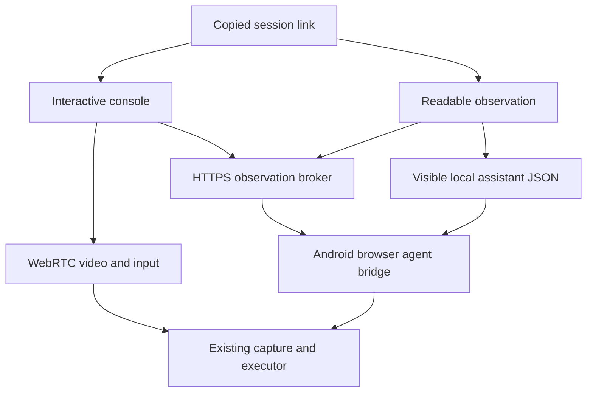

# One AI link, one Android capture/control core

The existing **Connect with AI through link** button creates a temporary capability URL, copies it and starts the existing screen-sharing foreground service after Android consent. Browser login, OTP and another setup wizard are unnecessary. Existing MCP keeps its separate entry point and established ownership rules.

| Agent capability | Observation | Action transport |
| --- | --- | --- |
| Interactive cloud browser | WebRTC video; HTTPS image when video cannot connect | Click/hold/drag on the same letterbox-aware surface; existing binary DataChannel or validated HTTPS fallback |
| Fetch/image reader on the same phone | Server-rendered status and explicit JPEG URL | Complete JSON in a visible, identifiable assistant message; local Accessibility listener |
| MCP agent | Existing observation tools | Existing MCP tools |
| Fetch-only agent in another device/cloud | Status/JPEG where its runtime can inspect images | Requires an action tool/browser/MCP or a local companion; a link alone cannot deliver its chat output |

## Why the black/Connecting screen could not recover

Previously **Fresh screenshot** drew from the same video element. No decoded WebRTC frame meant no screenshot, even when the HTML and controls had loaded. A URL fragment also cannot provide a server-rendered, fetch-only observation. The new query capability reaches the server, with no-referrer, no-store and query-string log redaction. Old fragment links remain usable by interactive browsers.

The independent authenticated host-agent WebSocket stays attached to the service across WebRTC peer replacement. It requests frames from `AiSnapshotProvider` on the existing `ScreenCaptureTrack`: no second MediaProjection, encoder or permanently retained GPU texture. JPEG work occurs only for observation requests. P2P/TURN remains the live video path; fallback screenshots are for observation/control compatibility and are not a high-FPS video replacement.

The HTML reports phone offline, screenshot pending, setup/protected screen, or ready. Its screenshot URL is bound to an observation ID; it cannot silently serve a different frame for old coordinates. A decoded video frame plus a matching control HELLO is required before the native live route becomes interactive. Mouse coordinates subtract the actual contained image/video letterbox before normalization.

## HTTP action lifecycle

1. Explicit POST claims a stable browser identity. GET previews neither claim nor execute.
2. Observe returns observationId, screenVersion, currentPackage, display geometry and commandNonce.
3. POST action submits a unique actionId, normalized parameters and that observation.
4. The Durable Object persists a bounded request record. The phone obtains an atomic start grant, checking expiry and the current browser epoch/instance.
5. The phone checks the same MCP observation ledger, privacy context, fresh pixels, semantic target and display generation. Browser coordinates remain exact rather than snapping to another button.
6. Dispatch uses the existing Accessibility executor and lease/sequence gates. A refused command is false; a timed-out completion is unknown, not success.
7. The result includes a newly captured observation when available. Requests are not automatically replayed. Repeating the same ID retrieves its recorded result; a different payload under that ID is rejected.

A replacement tab cannot start an old queued command. A started command cannot be retroactively undone; its result must be inspected. A crash after dispatch leaves an unknown result and requires observation before another action. Stop/expiry revokes both routes and clears stored frames/results.

## Visible local chat JSON

A session-bound listener accepts one complete `AARIS_ACTION_BEGIN` / `AARIS_ACTION_END` block. It rejects duplicate JSON keys, unknown fields, unsupported actions, incomplete streamed text, stale/used observations, invalid coordinates and the wrong nonce. It never scans WhatsApp, password fields or arbitrary application text for commands.

The current allowlist includes native ChatGPT, Claude, Copilot and Perplexity package names. An assistant-specific resource ID or assistant-only response toolbar must be accessible within the bounded visible message container; user/editable messages are excluded. Third-party versions, languages and custom-rendered chat layouts may hide these markers. Such layouts fail closed and require device verification; allowlisting a package does not guarantee its UI exposes identifiable assistant messages.

After text is stable, a local command targeting a prior screenshot restores that application first. A restored window must have the same package, privacy masks, relevant target and matching fresh pixels. Navigation without a stable semantic target never bypasses the observation/lease checks. The target screenshot is cached before returning to the AI app, so the next link read observes the target rather than recursively observing the chat. Reopening the AI app does not guarantee its inference survives Android background process termination.

Aaris capture, transport, listener and gesture execution are service-owned and independent of the Activity. Opening WhatsApp does not stop them. Accessibility can inspect active/visible windows; Cloudflare has no access to ChatGPT's private screen or hidden conversation. Process death, projection revocation, lock/secure content and OEM battery policies remain Android constraints. A killed projection cannot be restarted using an old consent token.

## Verification

- Worker tests: read-only previews, state/status, immutable screenshot identity, browser replacement, one atomic action grant, duplicate/conflicting IDs, close/revoke, and existing phone-to-phone protocol.
- Chromium: real RTP/SCTP live video and binary gestures, then a separate no-WebRTC test using HTTPS screenshots, exact coordinate/Home actions, letterbox exclusion and stateless reload.
- Android: strict JSON parsing/provenance input, exact coordinates, restored-window pixel/target checks; full unit tests, debug/release lint and builds.
- Existing synthetic gaming smoothness matrix continues to exercise cadence governors.
- Production smoke: real deployed HTTP/host-agent WebSocket, readable status/image, action delivery, atomic start, synthetic ACK, replay/replacement fencing and revocation.
- Physical Android/OEM background behavior and third-party assistant toolbar layouts require real device testing. Synthetic peers do not prove every phone/network has smooth video.

The design follows [WebRTC peer/signaling/TURN guidance](https://webrtc.org/getting-started/peer-connections), [Android projection/service requirements](https://developer.android.com/media/grow/media-projection), [Accessibility active-window APIs](https://developer.android.com/reference/android/accessibilityservice/AccessibilityService), and [Cloudflare hibernating WebSockets](https://developers.cloudflare.com/durable-objects/best-practices/websockets/). [Meta's RTC architecture](https://engineering.fb.com/2020/12/21/video-engineering/rsys/) similarly separates signaling responsibilities; this project reuses its current WebRTC and input core rather than adding another streaming stack. WebRTC's [resource adaptation](https://chromium.googlesource.com/external/webrtc.git/+/HEAD/video/g3doc/adaptation.md) also makes clear that cadence depends on actual resource/network capacity; FPS cannot be guaranteed to increase indefinitely.
